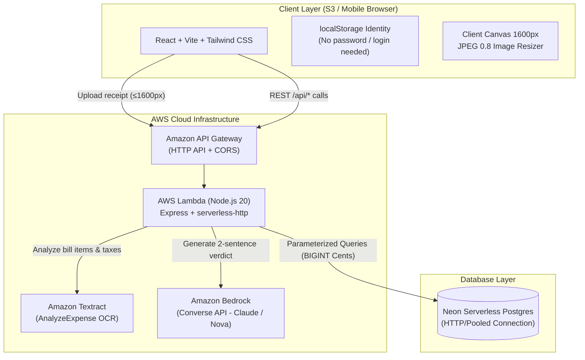

# ⚖️ Group Expense Court

> **Split restaurant bills and shared expenses without arguing. The courtroom gavel settles all.**

An Ethiopian-tailored, full-stack serverless expense splitting app featuring an authentic **courtroom theme**: "Case files" (expenses), an interactive "Gavel" button, "AI Debt Detective" verdicts, and a competitive "Hall of Shame" punctuality leaderboard.

---

## 🏛️ System Architecture



---

## ✨ Key Features & Flow

1. **Zero Login Friction**: Create a court to receive a code (`COURT-4821`) or join using a code. Member identities are scoped to the court and remembered in `localStorage`.
2. **Ethiopian Market Bill Handling**: Real Ethiopian bills include 15% VAT and 10% Service charges. Line items are divided among eaters, and extra taxes/fees are distributed **proportionally** using the **Largest-Remainder (Hamilton-Hare) Method** down to the exact cent.
3. **Smart Receipt OCR**: Users can upload a photo of their receipt. Amazon Textract's `AnalyzeExpense` extracts items and taxes. If the image is blurry or Textract fails, it gracefully falls back to manual entry without breaking the user experience.
4. **Fewest-Payments Algorithm**: Computes net balances per member ($\sum \text{net} = 0$) and runs a greedy settlement algorithm that reduces complex web of debts (e.g. 12 transactions down to 4).
5. **AI Debt Detective (Code Decides, AI Narrates)**: When a member files a claim about an expense, deterministic code decides the outcome (`Verified`, `Needs Evidence`, or `Case Dismissed`), and Amazon Bedrock generates a humorous 2-sentence courtroom verdict in English, Amharic (አማርኛ), or Afaan Oromo. Pre-written fallbacks ensure verdicts always render even if Bedrock times out.
6. **Hall of Shame Leaderboard**: Ranks court members by average hours to settle up and outstanding debts, awarding titles such as *"Bole Jet ⚡"*, *"Buna First, Birr Later ☕"*, and *"The Tomorrow Guy (Nege Inkedalelen)"*.

---

## 📂 Repository Structure & Folder Explanation

Here is a beginner-friendly breakdown of every folder:

| Directory | Purpose | What's Inside |
| :--- | :--- | :--- |
| `shared/` | **Pure Business Logic** | Zero-dependency, pure math & algorithms. Converts currency cents (`money.js`), calculates exact proportional bill splits (`split.js`), and computes fewest debt settlements (`settle.js`). Includes comprehensive Vitest unit tests. |
| `backend/` | **Express & Cloud Functions** | Express app running identically on local Node.js (`src/local.js`) and AWS Lambda (`src/lambda.js`). Contains Textract OCR (`textract.js`), AI Judge (`judge.js`), Neon Postgres client (`db.js`), and REST route handlers. |
| `db/` | **Database Schema & Migrations** | PostgreSQL DDL script (`schema.sql`), idempotent demo data (`seed.sql`), and a Node runner (`migrate.js`) to set up your Neon database with one command. |
| `frontend/` | **User Interface** | React + Vite + Tailwind CSS mobile-first web app. Includes multilingual support in English, Amharic, and Afaan Oromo (`i18n.js`), client-side image compression, and court-themed views. |
| `deploy/` | **Cloud Infrastructure** | AWS SAM template (`template.yaml`) for deploying the Lambda function and HTTP API with least-privilege IAM roles, plus a copy-paste deployment guide (`DEPLOY.md`). |

---

## 🧪 Testing the Math & Logic

All financial calculations avoid floating-point math by storing amounts in integer cents (1 ETB = 100 Cents).

Run the automated test suite:
```bash
npm test
```

### Verified Test Cases:
- **Test A (Split)**: Shiro 200.00 ETB (Selam), Kitfo 450.00 ETB (Eyob), Tibs 350.00 ETB (Abebe), Extras 250.00 ETB $\rightarrow$ Proportional shares sum **exactly** to 1,250.00 ETB without lost cents.
- **Test B (Shared Remainder)**: 300.01 ETB shared among 3 people distributes remainder cents deterministically.
- **Test C (Settlement Minimization)**: Eyob +750.00, Selam +150.00, Abebe -450.00, Dawit -450.00 settles in **exactly 3 transactions**.
- **Test D (Invariant Property)**: 100 randomized multi-item expenses prove sum of all member net balances is **always exactly 0**.

---

## 🏃 Running Locally

### 1. Configure Environment
Copy `.env.example` to `.env`:
```bash
cp .env.example .env
```
*(Optional: If `DATABASE_URL` is omitted, the app automatically runs in local memory mode pre-seeded with the `COURT-4821` Demo Court dataset!)*

### 2. Start Backend (Port 3001)
```bash
cd backend
npm install
npm run dev
```

### 3. Start Frontend (Port 5173)
```bash
cd frontend
npm install
npm run dev
```
Open [http://localhost:5173](http://localhost:5173) in your browser. Tap **"Enter COURT-4821"** to test immediately with real Ethiopian bill records!

---

## 📸 Screenshots & Court Walkthrough

1. **The Courtroom Docket (Home / Group)**:
   View active members, total expenses in ETB, and case files with one-click access to Settle Up.
2. **New Case Wizard (Receipt OCR & Chip Assignment)**:
   Upload receipt photo $\rightarrow$ Amazon Textract reads items $\rightarrow$ Tap member chips to assign who shared each dish $\rightarrow$ Live proportional tax calculation preview.
3. **The Settlement Chamber**:
   Visual check confirming $\sum \text{Balances} = 0$, transaction reduction badge (*"12 payments reduced to 4"*), and one-click copyable SMS/Telegram payment reminder.
4. **AI Debt Detective (Bedrock Verdict)**:
   File a dispute $\rightarrow$ Code validates claim count vs receipt count $\rightarrow$ Amazon Bedrock delivers a playful 2-sentence courtroom verdict in your selected language.
5. **Hall of Shame**:
   Public ranking board tracking payment punctuality and pending debts.

---

## 👥 Hackathon Team & Presentation Guide

### 🧑‍💻 AWS & Cloud Focus Student:
- **Architecture Pitch**: Highlight serverless economics. Node.js Express wrapped with `serverless-http` on AWS Lambda means **zero idle cost**.
- **Security & IAM**: Mention least-privilege IAM policies in `deploy/template.yaml` (`textract:AnalyzeExpense` and `bedrock:InvokeModel` only).
- **Resilience**: Point out client-side image resizing (canvas 1600px JPEG 0.8) preventing API Gateway 6MB payload drops, and 5-second Bedrock fallback timeouts.

### 🎨 Frontend & Product Focus Student:
- **Courtroom Metaphor**: Explain how turning awkward money talks into playful legal theater ("Case files", "Gavel button", "Hall of Shame") makes splitting fun.
- **Local Context**: Highlight Ethiopian Birr (ETB) formatting, Amharic & Afaan Oromo language options, and proportional splitting for VAT + service charge.
- **Zero-Friction UX**: No signups, no email verification; users join in 3 seconds via 4-digit court code.
